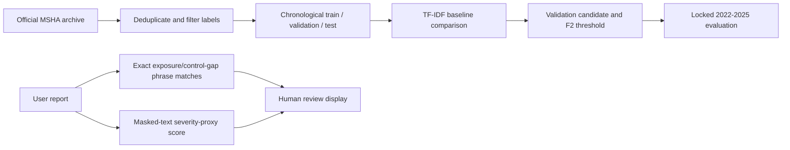

# An Auditable Public-Data Baseline for SIF-Related Incident Text Screening

## A retrospective severity proxy with a separate explicit-cue layer

**Research prototype manuscript — November 2026**

### Abstract

Serious injury and fatality (SIF) precursor screening is constrained by limited access to incident narratives with independently assigned potential-severity labels. This work builds a reproducible public-data baseline and makes that label gap explicit. We use 257,509 deduplicated Mine Safety and Health Administration (MSHA) incident records from 2000–2025, defining a retrospective binary outcome proxy from recorded fatalities and permanent total/partial disabilities versus selected lower-outcome codes. We compare TF–IDF Logistic Regression and Linear SVM models across narrative, structured-context, and combined feature views, select the model using validation average precision, and hold out 2022–2025 chronologically. The chosen TF–IDF Logistic Regression with direct outcome terms removed achieves test average precision 0.3995 (95% record-bootstrap CI 0.3472–0.4601), recall 0.5565, and precision 0.3177 at a validation-selected F2 threshold. To avoid conflating historical outcomes with prospective precursors, a deterministic user-facing cue panel independently reports exact matches to configured high-energy and direct-control-gap phrases. This public-data prototype improves reproducibility and leakage awareness over synthetic-only demonstrations, but it does not establish Oil India performance or identify expert-labeled SIF potential.

**Index Terms—** occupational safety, incident narratives, serious injury and fatality, text classification, MSHA, explainability, public data.

## I. Introduction

Organizations accumulate incident narratives, but manual review can be slow and potential-SIF labels are often scarce. Prior research has explored supervised NLP for extracting injury precursors and classifying injury narratives [1], [3]. More recent PSIF work uses transformer representations, heterogeneous incident fields, and weak supervision to extend sparse labels [2]. These studies also highlight a central evaluation problem: outcomes recorded after an incident are not the same target as whether a pre-incident condition had the potential to cause a serious injury or fatality.

The project began from the need for real public examples because the exact target domain’s operational HSSE reports were unavailable. Public SIH 2026 repositories reviewed for this work frequently describe synthetic demo records, rule-derived labels, data-ingestion prototypes, or small demonstrations. They are useful as software and workflow references, but their scores do not form a matched benchmark. We therefore select an official public dataset with real incident narratives and explicit injury-degree codes, and narrow the claim to a retrospective severity proxy.

The contributions are: (1) an auditable public-data pipeline with source hashing and deduplication; (2) a chronological train/validation/test evaluation; (3) a comparison of text/context feature views with direct outcome-word masking; (4) rare-class metrics and a majority baseline; and (5) an independent literal cue matcher that exposes its exact phrases without presenting rules as learned causal explanations. These contributions are engineering and evaluation practices, not a claim of a new state-of-the-art SIF model.

## II. Related Work and Public SIH Implementations

Baker et al. compare TF–IDF/SVM, CNN, and hierarchical attention approaches on more than 90,000 private oil-and-gas incident reports and show that predictive text can be inspected for precursor patterns [1]. Their study also identifies post-event outcome language as a leakage hazard. Parikh et al. combine transformer encodings with XGBoost and heterogeneous fields for potential SIF identification in a private corporate dataset, using expert-informed weak labeling and F2-oriented tuning [2]. Goldberg evaluates word-embedding representations for OSHA narrative coding and cross-domain transfer [3]. A systematic review of occupational injury text analytics similarly identifies text classification, representation choices, and sparse labels as recurring issues [4].

Public SIH repositories add practical framing around high-energy exposures and failed direct controls. The reviewed Sentinel_SIF implementation uses synthetic development examples; Ppoloju’s SIH-SIF project documents a synthetic demo alongside public-source ingestion scripts; other repositories are ingestion-only or documentation-first. Table I summarizes the implementation evidence observed in the repositories as of Nov. 23, 2026. Repository README descriptions and demonstration metrics are not independent validation results.

**TABLE I — PUBLIC SIH 2026 PROJECT COMPARISON**

| Repository | Data/model approach reported | Reusable lesson | Why metrics are not directly comparable |
|---|---|---|---|
| Ppoloju/SIH-SIF-Precursor-Detection | Synthetic demo; scripts reference MSHA, OSHA, and BSEE public data | Preserve source provenance and narrative evidence | Mixed sources and rule-derived labels differ from this target |
| MnSykia/Sentinel_SIF | Synthetic development data; high-energy plus direct-control framing | Separate hazard energy from barrier status | Synthetic examples do not establish real-data performance |
| prasanna456186/sif-sentinel | Ingestion/handoff work; classifier deferred | Normalize sources before modeling | No trained benchmark in reviewed version |
| shlok926/oil-safety-intelligence-platform | Documentation/placeholder workflow | Clear problem framing | No implemented, evaluated model in reviewed version |
| Predictive-Safety-Intelligence/sih26165-sif-precursor-engine | Small TF–IDF/One-vs-Rest case-grouped experiment reported | Group related records where possible | Small, different labels and corpus |
| Kirthik-Roshan/SIF-Guard; ujjvaltiwari-arch/sif-precursor-detection | Synthetic demos/baseline architecture | Make workflow demonstrable | Synthetic labels are not an external benchmark |

## III. Dataset and Target Definition

### A. Source selection

The official MSHA Accident/Injury dataset was selected because it provides a large public narrative corpus with coded injury degree. The downloaded archive is reproducible through a project script; the local archive and extracted narratives are ignored by Git, while the downloader records source URL, retrieval time, and SHA-256. The data source covers mining, not Oil India operations [7].

The OSHA Severe Injury Report data were retained only for descriptive exploration. OSHA SIR contains reports involving hospitalization, amputation, or loss of an eye and excludes fatalities [8]. It therefore cannot provide the intended comparison of fatalities/permanent disability against lower recorded injury outcomes. OSHA ITA case details were examined as an alternative; the evaluated extract had only 229 death-coded cases overall and 37 records with NAICS prefix 21, and the reporting population is constrained by electronic submission requirements [9].

### B. Label and exclusions

The positive label is MSHA degree code 01 (fatality) or 02 (permanent total/partial disability). The negative label is codes 00, 03, 04, 05, 06, and 10. Occupational illness (07), natural causes (08), non-employees (09), unknown codes, and records outside 2000–2025 are excluded. Records with duplicate `MINE_ID` + `DOCUMENT_NO` are deduplicated. Employer and location identifiers are retained only for grouping/audit and are excluded from model inputs.

The target is an observed post-incident administrative outcome. It is **not** potential severity, a near-miss label, a hazard label, or a prospective risk outcome. Since narratives are written after incidents, even outcome-word masking cannot remove every retrospective clue.

### C. Split design

**TABLE II — TEMPORAL DATA PARTITIONS**

| Partition | Years | Records | Positive | Positive rate |
|---|---:|---:|---:|---:|
| Training | 2000–2018 | 218,092 | 3,010 | 1.38% |
| Validation | 2019–2021 | 16,954 | 269 | 1.59% |
| Locked test | 2022–2025 | 22,463 | 354 | 1.58% |
| Total eligible | 2000–2025 | 257,509 | 3,633 | 1.41% |

This chronological split prevents future-year records from informing the earlier training window. Validation average precision selects the candidate; the F2 threshold is selected on validation. The test partition is held out until final evaluation.

## IV. Model and Interface

### A. Comparative baselines

The pipeline compares TF–IDF unigram/bigram Logistic Regression and Linear SVM with four text views: raw narrative (diagnostic only), narrative with direct outcome terms removed, structured context only, and masked narrative plus selected context. Context includes activity, classification, accident type, equipment, subunit, and occupation. The raw narrative experiment is deliberately excluded from deployment selection because it can exploit post-outcome wording. Class weighting addresses imbalance; average precision is emphasized because the positive class is rare. F2 is used for validation threshold selection to weight recall more heavily than precision.

The selected candidate is Logistic Regression over masked narrative plus context. It outputs an uncalibrated decision score. Coefficient-based token contributions show which features push a score up or down; they are a model-behavior explanation, not a causal explanation.

### B. Explicit cue layer

The separate cue layer checks configured phrase lists for high-energy exposures (e.g., work at height, energized equipment, mobile machinery, suspended loads, confined spaces) and explicit control-gap statements (e.g., “not locked out,” “no spotter,” “without fall protection”). The interface displays the exact matched phrases and whether the text contained exposure language, control-gap language, or both. An unmatched phrase is never interpreted as a control being present or a situation being safe. Rules are transparent and editable in `configs/precursor_rules.json`; they do not feed into the classifier score.

### C. Workflow

## V. Results

The test partition contains 22,463 reports, including 354 positives (1.576%). The selected model achieved average precision 0.3995, with a record-level bootstrap 95% confidence interval of 0.3472–0.4601; ROC-AUC was 0.9523. At the validation-selected F2 threshold, precision was 0.3177 and recall was 0.5565. The confusion matrix contains 197 true positives, 423 false positives, 21,686 true negatives, and 157 false negatives. The always-negative average-precision baseline equals the test prevalence, 0.0158.

**TABLE III — LOCKED TEST RESULTS**

| Measure | Result |
|---|---:|
| Average precision (95% CI) | 0.3995 (0.3472–0.4601) |
| ROC-AUC | 0.9523 |
| Precision | 0.3177 |
| Recall | 0.5565 |
| F1 / F2 | 0.4045 / 0.4838 |
| Specificity | 0.9809 |
| TP / FP / TN / FN | 197 / 423 / 21,686 / 157 |
| Always-negative AP | 0.0158 |

At this operating point, the model misses 157 positive records and raises 423 false alerts. The score should therefore support research triage only and requires human review. High ROC-AUC should not obscure the moderate precision-recall results under severe imbalance.

## VI. Discussion: Improvements and Remaining Gaps

Relative to synthetic-only public demonstrations, this project contributes a large real corpus, a reproducible source acquisition path, explicit outcome-code definitions, deduplication, a forward-in-time holdout, leakage diagnostic, prevalence-aware baseline, and test uncertainty interval. Relative to a single opaque flag, the interface separates an interpretable literal-cue checklist from the learned severity-proxy model. This makes it easier to inspect the wording behind each output and to avoid turning absent terms into claims of safety.

The present system is less aligned to genuine SIF potential than the private-data PSIF studies [2]. MSHA codes describe what injury occurred, not how severe an incident could have been under different circumstances. The user-facing cue matcher partly addresses transparency and hazard/control language, but its phrases are hand-authored and not validated by domain experts. It does not improve the classifier’s performance and is not an automated risk score.

The most valuable next steps are: (1) acquire a target-domain corpus of near misses and unsafe-condition reports; (2) have multiple safety experts independently label potential severity and barrier status; (3) report inter-rater agreement and adjudication rules; (4) evaluate source/time and organization shifts; (5) group bootstrap confidence intervals by incident or site; (6) compare modern domain-adapted encoders only after establishing a trustworthy label set; and (7) calibrate thresholds to an explicitly defined review capacity. No synthetic samples should be presented as evidence of real-world model quality.

## VII. Limitations and Responsible Use

The key limitation is domain/construct mismatch: mining outcomes are used as a proxy for severity-coded incident language, not as Oil India SIF potential. There may be historical reporting biases, changes in language over time, and residual post-event leakage. The test interval is temporal but remains within the same public source and domain. The confidence interval resamples records, not mine/site clusters, so it may understate correlated uncertainty. Rule coverage is incomplete, English phrase matching is brittle, negation and context may be mishandled, and the hand-authored taxonomy has not been independently assessed.

This prototype is for research and human review. It must not be used to rank workers, sites, or employers, to declare a work condition safe, to replace expert assessment, or to direct operational decisions.

## VIII. Conclusion

A real-data baseline was built from public MSHA records, with a strict temporal evaluation and transparent reporting. Its measured performance is substantially above the prevalence baseline but does not validate a prospective SIF precursor model. The project’s defensible contribution is the auditable pipeline, careful distinction between outcome labels and potential-severity labels, leakage-aware baselines, and a separate exact-evidence cue panel. A target-domain, expert-labeled dataset is necessary before making claims about actual SIF precursor identification.

## References

[1] H. Baker, M. R. Hallowell, and A. J.-P. Tixier, “Automatically learning construction injury precursors from text,” *Automation in Construction*, vol. 118, Art. no. 103145, 2020, doi: 10.1016/j.autcon.2020.103145.

[2] P. Parikh, J. Penfield, and M. Juaire, “Automatic identification of incidents involving potential serious injuries and fatalities (PSIF),” *Scientific Reports*, vol. 14, Art. no. 8091, 2024, doi: 10.1038/s41598-024-58824-y.

[3] D. M. Goldberg, “Characterizing accident narratives with word embeddings: Improving accuracy, richness, and generalizability,” *Journal of Safety Research*, vol. 80, pp. 441–455, 2022, doi: 10.1016/j.jsr.2021.12.024.

[4] M. Z. F. Khairuddin *et al*., “Predicting occupational injury causal factors using text-based analytics: A systematic review,” *Frontiers in Public Health*, vol. 10, Art. no. 984099, 2022, doi: 10.3389/fpubh.2022.984099.

[5] A. Bayona, M. R. Hallowell, and S. Bhandari, “The things that hurt people are not the same as the things that kill people: Key differences in the proximal causes of low- and high-severity construction injuries,” *Journal of Construction Engineering and Management*, vol. 150, no. 8, Art. no. 04024089, 2024, doi: 10.1061/JCEMD4.COENG-14545.

[6] R. Liu, H.-C. Liu, H. Shi, and X. Gu, “Occupational health and safety risk assessment: A systematic literature review of models, methods, and applications,” *Safety Science*, vol. 160, Art. no. 106050, 2023, doi: 10.1016/j.ssci.2022.106050.

[7] U.S. Mine Safety and Health Administration, “MSHA open government data: Accident/injury data sets.” [Online]. Available: https://arlweb.msha.gov/opengovernmentdata/ogimsha.asp. Accessed: Nov. 23, 2026.

[8] U.S. Occupational Safety and Health Administration, “Severe injury reports.” [Online]. Available: https://www.osha.gov/severe-injury-reports. Accessed: Nov. 23, 2026.

[9] U.S. Occupational Safety and Health Administration, “Injury Tracking Application data.” [Online]. Available: https://www.osha.gov/itadata. Accessed: Nov. 23, 2026.

[10] Ppoloju, “SIH-SIF-Precursor-Detection,” GitHub repository. [Online]. Available: https://github.com/Ppoloju/SIH-SIF-Precursor-Detection. Accessed: Nov. 23, 2026.

[11] MnSykia, “Sentinel_SIF,” GitHub repository. [Online]. Available: https://github.com/MnSykia/Sentinel_SIF. Accessed: Nov. 23, 2026.

[12] Predictive-Safety-Intelligence, “sih26165-sif-precursor-engine,” GitHub repository. [Online]. Available: https://github.com/Predictive-Safety-Intelligence/sih26165-sif-precursor-engine. Accessed: Nov. 23, 2026.
